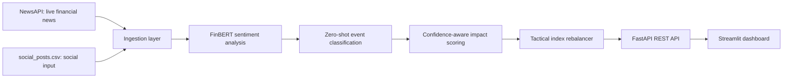

# AI/NLP Financial Risk Engine - S&P Global & Crisil Campus Hackathon

**Candidate Name:** Dakshesh  
**College Email ID:** f20230727@goa.bits-pilani.ac.in  
**College / Campus:** BITS Pilani Goa Campus  
**Demo Video Link:**   
**Slide Deck Link:** 

## 1. Project Overview / Problem Statement & Approach

Financial risks often emerge first in unstructured information such as news articles and social-media discussions. These sources are difficult to consume consistently at scale, and a portfolio manager needs concise, explainable signals before deciding how to respond. The challenge is to transform this text into structured sentiment, event, and severity information that downstream financial applications can use.

This project implements a unified AI/NLP Financial Risk Engine and Module A: Tactical Index Rebalancing. It ingests live financial news through NewsAPI and social-media-style posts from a CSV source. Each item is analysed for financial sentiment, event type, confidence, and market impact. The resulting signals update a ten-stock mock index, and a Streamlit dashboard visualizes the incoming information, the previous and new weights, and portfolio-weight history.

The engine uses pretrained language models rather than keyword matching. FinBERT interprets financial sentiment from complete English text, while a zero-shot classifier assigns event categories such as Earnings, Regulatory, Macroeconomic, or Geopolitical. This keeps the risk signals more robust when wording is mixed, indirect, or contains negation.

## 2. Architecture & Tech Stack

### System design and data flow



### Tech stack

| Area | Technology |
| --- | --- |
| Language | Python 3.13 |
| API | FastAPI and Uvicorn |
| Dashboard | Streamlit and Plotly |
| Data processing | Pandas |
| Sentiment model | `ProsusAI/finbert` via Hugging Face Transformers |
| Event classifier | `facebook/bart-large-mnli` zero-shot classifier |
| Live news | NewsAPI `/v2/everything` endpoint |
| Persistence | JSON files for rebalancing history and processed NewsAPI article IDs |

## 3. Dataset Used

### Live news input

The application retrieves recent English-language articles through NewsAPI. It searches article titles and descriptions for companies in the mock index: NVIDIA, Tesla, Apple, JPMorgan, Exxon, Microsoft, Amazon, Alphabet, Meta, and Walmart. A maximum of five recent articles is used in each live-news request.

### Social-media-style input

`data/raw/social_posts.csv` is a synthetic CSV dataset representing financial social posts. It contains these columns:

```csv
source,company,text
social,NVDA,Nvidia looks strong after earnings beat expectations.
```

### Assumptions

- NewsAPI headlines and descriptions provide enough text for a hackathon-scale NLP demonstration.
- The mock index begins with ten stocks at an equal 10% allocation.
- A positive risk signal increases the related stock weight; a negative signal decreases it.
- NewsAPI articles affect the portfolio once only. Their URLs are saved after a successful rebalance and are cleared when the portfolio is reset.
- Social CSV posts are processed on each run, allowing the team to modify the dataset and demonstrate different scenarios.
- The system estimates sentiment and event risk; it does not claim to guarantee future stock-price movement.

## 4. Quickstart & Installation

**Runtime:** Python 3.13 on Windows 11

### Prerequisites

- Python 3.11 or later
- A free [NewsAPI](https://newsapi.org/) API key
- Git

### Setup

```powershell
git clone <your-repository-url>
cd BITS_Goa-Dakshesh-hackathon

py -m venv .venv
.\.venv\Scripts\Activate.ps1

python -m pip install --upgrade pip
python -m pip install -r requirements.txt

Copy-Item .env.example .env
```

Open `.env` and add your NewsAPI key:

```text
NEWS_API_KEY=your_real_newsapi_key
```

Never commit `.env`; it is excluded by `.gitignore`.

### Run locally

Open two terminals in the project root. Activate the virtual environment in both terminals.

**Terminal 1 — FastAPI server**

```powershell
uvicorn src.main:app --reload
```

API documentation: [http://127.0.0.1:8000/docs](http://127.0.0.1:8000/docs)

**Terminal 2 — Streamlit dashboard**

```powershell
streamlit run dashboard\app.py
```

Open the Streamlit URL printed in the terminal, usually [http://localhost:8501](http://localhost:8501).

## 5. Key Results & Domain Impact

### Prototype output

For every news or social input, the engine creates a structured risk signal containing:

```json
{
  "source": "newsapi",
  "company": "NVDA",
  "sentiment_score": 0.74,
  "sentiment_label": "positive",
  "sentiment_confidence": 0.91,
  "event_classification": "Earnings",
  "event_confidence": 0.73,
  "impact_score": 7
}
```

The dashboard demonstrates:

- Ingestion of live NewsAPI and social CSV text.
- Sentiment, confidence, event type, and impact score for each item.
- Original, previous, and rebalanced stock weights.
- Portfolio-weight history over repeated runs.
- Prevention of duplicate NewsAPI articles from changing the portfolio until reset.

### Domain impact

The prototype shows how a risk team can transform unstructured, fast-moving information into an explainable signal stream for decision support. It provides a simple but practical example of sentiment-responsive portfolio management: strong positive or negative financial signals change exposure while uncertain model output is handled conservatively.

For the hackathon, the rebalancing rule is intentionally transparent. A production system could extend this work with authenticated live social feeds, company entity resolution, market-price backtesting, more portfolio constraints, and human review for high-impact events.

## Repository Structure

```text
data/
  raw/
    social_posts.csv
    stocks.csv
  processed/
dashboard/
  app.py
src/
  ingestion/
    loader.py
    news.py
  nlp/
    finbert_sentiment.py
    event_classifier.py
  main.py
  models.py
  pipeline.py
  rebalancer.py
```

## Demo Flow

1. Open the dashboard and click **Reset Portfolio to 10%**.
2. Show the equal initial stock allocations.
3. Click **Run Risk Analysis and Rebalance Index**.
4. Show incoming NewsAPI and social signals with their model outputs.
5. Compare previous and new portfolio weights.
6. Show the portfolio-history chart.
7. Before rerunning, update `data/raw/social_posts.csv` with new posts that keep the required `source,company,text` format. This simulates newly arriving social information.
8. Run again. Any NewsAPI article already processed in an earlier run is ignored and cannot change the portfolio again.
9. Click **Reset Portfolio to 10%** to restore equal weights and clear the processed-NewsAPI record. Those same NewsAPI articles may then affect the fresh portfolio again.
