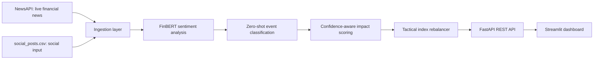

# System Architecture

## Data flow

1. The ingestion layer fetches unseen NewsAPI articles and reads social posts from the CSV source.
2. FinBERT returns financial sentiment and confidence.
3. The event classifier identifies the most relevant risk-event category.
4. Impact scoring combines sentiment strength, confidence, event severity, and source type.
5. The rebalancer updates the mock-index weights and stores the portfolio history.
6. The Streamlit dashboard displays signals, weights, and weight history.

## Duplicate-news handling

Processed NewsAPI article IDs are stored locally. An already processed article does not change the portfolio again until the user resets the portfolio to its equal 10% initial allocation.
